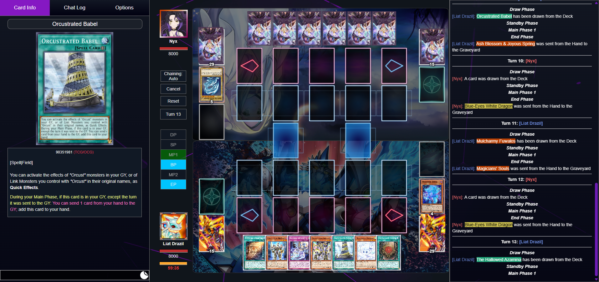

# DuelingNexus - Custom Layout & Event Log

A Tampermonkey userscript for **DuelingNexus** that adjusts the duel layout and moves the original event log into a fixed panel on the right side of the screen.

---

## Features

* **Custom Duel Layout:** Repositions and resizes the game field and side panels to make better use of the available screen space.
* **Right-Side Event Log:** Moves the original event log into a dedicated right-side panel and removes its redundant tab from the left panel.
* **Reorganized Tabs:** Expands the remaining left-panel tabs evenly to use the freed space.
* **Right-to-Left Life Bars:** The colored bar stays anchored on the left while its right edge moves left as life points decrease.
* **Stable Player Status:** Reserves space for each player's timer and timer bar while hidden, preventing the avatar and life display from shifting while allowing the game to show either timer when needed.
* **Bottom-Aligned Player Status:** Aligns the lower player's avatar, life points, and timer with the bottom edge of the play field, mirroring the upper player's top alignment.
* **Scroll-Aware Log:** Automatically follows new events while the log is at the bottom, and preserves your position when you scroll up to read earlier events.
* **Automatic Log Cleanup:** Removes standalone `undefined` entries from the event log.
* **Centered Duel Dialogs:** Keeps selection and other duel windows centered on the screen.
* **Responsive Updates:** Reapplies layout adjustments when the page changes or the browser window is resized.

---

## Installation

To use this userscript, install a browser extension that supports userscripts, such as **Tampermonkey**, **Violentmonkey**, or **Greasemonkey**.

1. Install a userscript manager, for example [Tampermonkey](https://www.tampermonkey.net/).
2. Install the script by opening the raw userscript link:
   * [Install script.user.js](https://raw.githubusercontent.com/LiatDrazil/DuelingNexus-Custom-Layout-and-Event-Log/main/script.user.js)
3. Confirm the installation in your userscript manager.

---

## Supported Pages

The script runs automatically on:

* `https://duelingnexus.com/duel/*`
* `https://duelingnexus.com/handtestmode*`

---

## Usage

After installation, open a supported DuelingNexus page. The layout changes are applied automatically; no in-game settings panel is required.

During a duel, the original event log appears on the right when the card panel is visible. The remaining tabs on the left expand evenly to use the available space. Scroll the log to review previous events; it resumes following new events when you return to the bottom.
